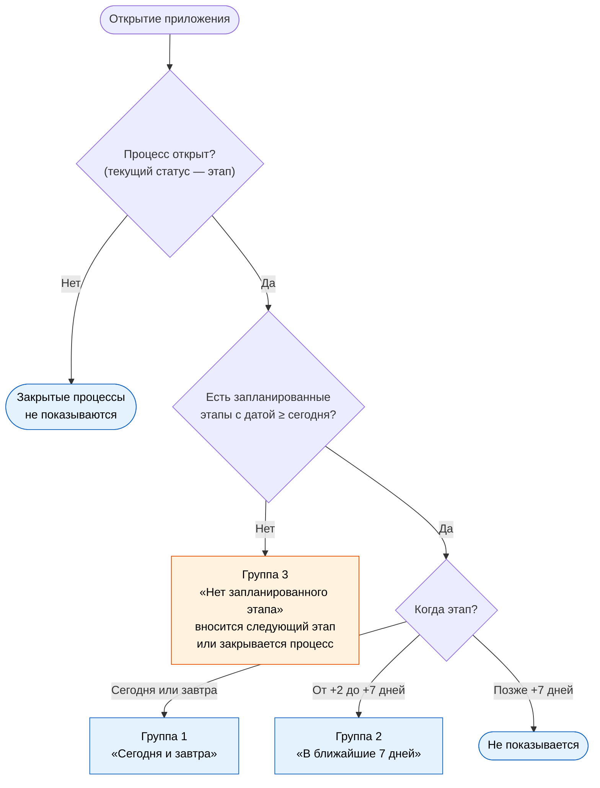
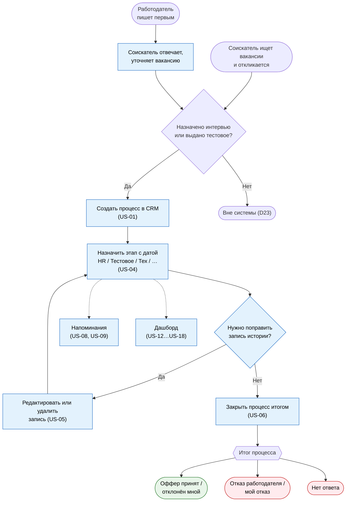

# Процесс поиска работы: TO-BE

| | |
|---|---|
| Версия | 3.0 |
| Дата | 20.10.2026 |
| Автор | Юрий Савиных |
| Статус | Утверждён автором |
| Связанные документы | [Vision & Scope](../requirements/01-vision-and-scope.md), [ADR-001](../adr/ADR-001-record-only-qualified-processes.md), [ADR-002](../adr/ADR-002-test-assignment-as-stage.md), [AS-IS](01-as-is-job-search.md), [Статусная модель](03-status-model.md) |

## 1. Назначение документа

Описать, как будет выглядеть поиск работы **с использованием CRM**: какие шаги остаются на
площадках, какие добавляются, что вводит соискатель и что делает система. Документ служит
основанием для пользовательских историй и модели данных.

## 2. Принципы

- **CRM не заменяет площадки.** Поиск, отбор, отправка откликов и переписка остаются в hh.ru,
  Telegram и почте. Отклики в CRM не фиксируются (решение D23, ADR-001).
- **Процесс создаётся, когда назначено интервью или выдано тестовое задание** (после отклика
  соискателя), либо когда работодатель вышел первым, вакансия релевантна и назначен этап.
- **Ввод минимален.** Обязательны направление, компания, название вакансии и начальный этап с
  датой; остальное подставляется из предыдущего процесса или необязательно (цель G4: не более
  1 минуты).
- **Статусы ставятся вручную** (D24, D14): система сама ничего не меняет и не закрывает.
- **Календарь остаётся у соискателя.** CRM хранит даты этапов (без времени) и показывает
  напоминания при открытии приложения (D21, D27).
- **Система предупреждает, а не блокирует** (нетипичные переходы статусов, D14).
- **Тестовое задание — обычный этап отбора** (D32, ADR-002): необязательный, порядок — между
  HR-интервью и Техническим собеседованием; срок сдачи и результат фиксируются текстом в
  комментарии к записи.
- **Записи истории можно редактировать и удалять** (D33, US-05): дата, комментарий, статус,
  причина отказа — в одном месте; удаление требует подтверждения.

## 3. Сценарий A: процесс после отклика соискателя

| № | Шаг | Что делает соискатель | Что делает система |
|---|-----|-----------------------|--------------------|
| A1 | Поиск вакансий | Как раньше: поиск по заданным параметрам на hh.ru, просмотр двух Telegram-каналов | CRM не участвует |
| A2 | Отбор и отправка отклика | Как раньше: решает, откликаться ли, определяет направление, отправляет отклик на hh.ru, в Telegram или на почту | CRM не участвует; отклик не фиксируется (D23) |
| A3 | Ожидание ответа | Ничего не делает. Отклики, по которым не назначено интервью или тестовое, остаются вне системы | CRM не участвует |
| A4 | Создание процесса | Когда назначено интервью или выдано тестовое, открывает форму быстрого ввода. Вводит направление, компанию, название вакансии и начальный этап с датой (по умолчанию «HR-интервью»; если первым выдано тестовое — «Тестовое задание», дата выдачи). Источник вакансии, канал отклика и канал общения подставлены из предыдущего процесса. По желанию вводит ссылку, тип работодателя, формат трудоустройства, вилку «на руки», контакт, комментарий (при тестовом первым — можно сразу записать срок сдачи текстом) | Создаёт процесс с начальным статусом и первой записью истории (статус, дата этапа, момент записи). Ссылка отображается кликабельной (D31) |
| A5 | Назначение этапа | При назначении этапа (HR-интервью, тестовое задание, техническое собеседование, знакомство с командой, СБ, оффер) устанавливает статус и вводит дату (для оффера — срок ответа; для тестового — дата выдачи). Время записывает в свой календарь. Если этап перенесли, правит дату; если отменили, удаляет запись этапа (D22) | Пишет запись истории с датой этапа. Для статуса «HR-интервью» и далее открывает ввод навыков вакансии (D8) |
| A6 | Тестовое задание | При получении тестового ставит этап «Тестовое задание» с датой выдачи и пишет в комментарий срок сдачи (например, «срок 25.10»). При сдаче — правит комментарий («сдано 24.10, ждём ответа») или, если тестовое не состоялось, удаляет запись этапа | Сохраняет запись истории; дата этапа попадает в напоминания. Отдельной сущности тестового задания больше нет (D32, ADR-002) |
| A7 | Уточнение условий | Если в ходе общения выяснены вилка, тип работодателя или формат трудоустройства, вносит их; любую вилку, указанную не «на руки», пересчитывает сам (D15) | Сохраняет значения |
| A8 | Завершение | Ставит итог: оффер принят, оффер отклонён мной, отказ работодателя или мой отказ. Если процесс дошёл до HR-интервью, тестового или позже, выбирает причину из справочника (D16) | Сохраняет итог и причину, пишет в историю |
| A9 | Работодатель замолчал | Если после этапа ответа нет и процесс не двигается, устанавливает итог «Нет ответа» (D26) | Сохраняет итог, пишет в историю |
| A10 | Напоминания | При открытии приложения смотрит стартовую страницу: «Сегодня и завтра», «В ближайшие 7 дней», «Нет запланированного этапа». Для процессов без запланированного этапа вносит следующий этап или закрывает процесс | Формирует три группы напоминаний (D27, раздел 6) |
| A11 | Правка истории | Если в записи истории ошибка, выделяет её в таблице карточки и нажимает «Редактировать» (дата, комментарий, статус, причина отказа) или «Удалить» с подтверждением. При смене статуса на нетипичный переход — предупреждение | Обновляет запись; текущий статус процесса пересчитывает триггер по последней записи; при удалении последней запрещённой к удалению (INV-18) возвращает ошибку (D33, US-05) |
| A12 | Анализ поиска | Открывает дашборд и фильтрует по направлению, инициатору, источнику, каналу отклика, типу работодателя и формату трудоустройства | Считает показатели Q1–Q9, Q12, Q13 с размером выборки |

## 4. Сценарий B: входящий контакт от работодателя

| № | Шаг | Что делает соискатель | Что делает система |
|---|-----|-----------------------|--------------------|
| B1 | Входящее сообщение | Работодатель пишет первым (около двух раз в неделю, чаще в Telegram) | CRM не участвует |
| B2 | Уточнение и решение | Как раньше: отвечает, уточняет детали вакансии. Если вакансия релевантна и назначен следующий этап, продолжает; иначе ничего не фиксируется (D11) | CRM не участвует |
| B3 | Создание процесса | Создаёт процесс: направление, компания, название вакансии, начальный этап с датой (по умолчанию «HR-интервью»), канал общения; ссылку, тип работодателя, формат, вилку, контакт и комментарий вводит при желании | Создаёт процесс с инициатором «работодатель»; источник вакансии и канал отклика не заполняются (D11, D12) |
| B4 | Дальнейшие этапы | Далее как в сценарии A, начиная с шага A5 | Как в сценарии A |

## 5. Данные процесса: что вводится и когда

| Поле | Когда вводится | Обязательность | Значение по умолчанию |
|------|----------------|----------------|-----------------------|
| Направление (SA/BA, TW) | Создание процесса | Обязательно | Значение предыдущего процесса |
| Компания | Создание процесса | Обязательно | Нет |
| Название вакансии | Создание процесса | Обязательно | Нет |
| Начальный этап и дата | Создание процесса | Обязательно | «HR-интервью»; при тестовом первым: «Тестовое задание» (D32) |
| Ссылка на вакансию (кликабельная) | Создание процесса или позже | Необязательно (D31) | Пусто |
| Источник вакансии (hh.ru, Telegram-канал, сайт компании, другое) | Создание процесса | Обязателен для процессов, начатых откликом; для входящих не заполняется | Значение предыдущего процесса; первый раз hh.ru |
| Канал отклика (hh.ru, Telegram, почта) | Создание процесса | Обязателен для процессов, начатых откликом; для входящих не заполняется | Значение предыдущего процесса; первый раз hh.ru |
| Канал общения (hh.ru, Telegram, почта, телефон) | Создание процесса | Обязателен (TQ10) | Значение предыдущего процесса; первый раз hh.ru |
| Инициатор (соискатель / работодатель) | Создание процесса | Определяется сценарием | Соискатель; «работодатель» в сценарии B |
| Тип работодателя (прямой работодатель / аутстафф / кадровое агентство) | Создание процесса или позже | Необязательно | Пусто, не подставляется (D20) |
| Формат трудоустройства (ТК / ГПХ (ИП/СЗ)) | Создание процесса или позже | Необязательно | Пусто, не подставляется (D20) |
| Зарплатная вилка «на руки», руб. (от, до) | Создание процесса или позже | Необязательно; вводится после самостоятельного пересчёта в «на руки» | Пусто |
| Контакт (имя, должность) | Создание процесса или позже | Необязательно | Пусто |
| Комментарий | В любой момент | Необязательно | Пусто |
| Статус и дата этапа | При каждом назначении этапа и смене статуса | Обязательно | Дата этапа: сегодня |
| Срок сдачи и результат тестового задания | В момент установки этапа «Тестовое задание» или позже | Необязательно | Пусто; фиксируется **текстом в комментарии** к записи этапа (D32) |
| Навыки вакансии | С момента «HR-интервью» (D8) | Необязательно | Пусто |
| Причина отказа | Закрытие отказом после HR-интервью, этапа «Тестовое задание» или позже (D16) | Обязательно в этих случаях (допустимо «без причины») | Нет |

Дата начала процесса отдельно не вводится: это дата первого этапа в его истории (D21). Записи истории можно редактировать (дата, комментарий, статус, причина отказа) или удалять с подтверждением (US-05, D33).

## 6. Напоминания (Q4)

Показываются на стартовой странице приложения при каждом открытии (D27). Правила расчёта: SR13 в документе «Статусная модель».

| Группа | Условие | Что делает соискатель |
|--------|---------|-----------------------|
| Сегодня и завтра | Этап приходится на сегодня или завтра | Информация, действие не требуется |
| В ближайшие 7 дней | Этап в период от сегодня + 2 до сегодня + 7 | Информация, действие не требуется |
| Нет запланированного этапа | Процесс открыт, у него нет этапа с датой не раньше сегодняшней. В списке показывается дата последнего этапа (D17) | Вносит следующий этап или закрывает процесс |

Сроки сдачи тестовых заданий больше не напоминаются (D32): если нужно, они пишутся в комментарии к записи этапа «Тестовое задание».

## 7. Как TO-BE решает проблемы AS-IS

| Проблема AS-IS | Решение в TO-BE |
|----------------|-----------------|
| P1. Отклики не фиксируются | Частично: фиксируются процессы с назначенным этапом (шаги A4, B3); сами отклики нет (D23) |
| P2. Нет единой истории процесса | Шаги A4–A9 и A11: история этапов с датами, возможностью редактирования записей и удаления |
| P3. Не фиксируются источник, канал и письмо | Частично: источник вакансии, канал отклика и канал общения фиксируются (шаг A4); письмо нет (D28) |
| P4. Безответные отклики обрабатываются неформально | Отклики без этапа остаются вне системы (D23); зависшие процессы видны в напоминаниях (A10) и закрываются вручную (A9) |
| P5. Не сохраняются этапы и причины отказов | Шаги A5, A8: статусы с датами и справочник причин |
| P6. Входящие не отделены от откликов | Сценарий B: инициатор «работодатель» (D11) |
| P7. Нет метрик | Шаг A12: описательные метрики и SQL-запросы Q1–Q9, Q12, Q13 |
| P8. Навыки и вилки не структурируются | Шаги A5, A7: навыки с HR-интервью, вилка «на руки», тип работодателя и формат трудоустройства |

## 8. Диаграммы BPMN

Диаграмма показывает оба сценария: A — соискатель откликнулся, назначено интервью или выдано тестовое; B — работодатель написал первым, стороны договорились об этапе. Отклики без этапа в CRM не фиксируются (D23). Полные правила смены статусов и расчёта воронки — в документе «Статусная модель» (SR1–SR14). Тестовое задание — обычный этап (D32, ADR-002).

## 9. Закрытые вопросы версии 2.0

| ID | Решение |
|----|---------|
| TQ10 | Канал общения обязателен для процессов обоих инициаторов, но подставляется из предыдущего процесса, поэтому ввод не растёт; он нужен для Q12 |
| TQ11 | Процесс можно создать сразу с любого этапа; по умолчанию предлагается «HR-интервью» (правило SR1 статусной модели) |

Открытых вопросов нет.

## 10. Закрытые вопросы версий 0.1 и 0.2 (актуальные)

| ID | Решение | Где отражено |
|----|---------|--------------|
| TQ2 | Значения канала общения: hh.ru, Telegram, почта, телефон; один канал на процесс, при смене канала поле правится | Раздел 5, D12 |
| TQ3 | Для входящих источник не заполняется, ссылка необязательна | Раздел 5, D31 |
| TQ4 | Хранятся даты всех этапов, прошедшие и запланированные; время не хранится | D21 |
| TQ5 | Поиск по базе до отклика не нужен: дубли исключены условиями учёта | D23 (прежний TQ5 снят) |
| TQ6 | Шаблонные отказы hh.ru не вносятся | Неактуально: отклики не фиксируются (D23, D19 отменено) |
| TQ7 | Формат трудоустройства: «ТК» и «ГПХ (ИП/СЗ)» | D20 |
| TQ8 | Перенос этапа: правка даты; отмена: удаление записи | D22 |
| TQ9 | Тип работодателя: прямой работодатель, аутстафф, кадровое агентство | D20 |

## 11. Журнал изменений

| Версия | Дата | Изменения |
|--------|------|-----------|
| 0.1 | 08.10.2026 | Черновик: сценарии A и B, состав данных, проверка дубля, список «Требуют действия», трассировка к проблемам AS-IS |
| 0.2 | 08.10.2026 | Закрыты TQ2–TQ6; добавлены тип работодателя и формат трудоустройства (D20); даты всех этапов (D21); шаблонные отказы hh.ru не вносятся (D19); список «Требуют действия» сведён к двум группам; ссылка на вакансию кликабельная; добавлены вопросы TQ7 и TQ9 |
| 1.0 | 08.10.2026 | Закрыты TQ7–TQ9: значения списков типа работодателя и формата трудоустройства, правка и удаление этапов (D22); любая вилка пересчитывается соискателем в «на руки»; открытых вопросов нет |
| 1.1 | 08.10.2026 | Документ утверждён автором без изменений содержания |
| 1.2 | 08.10.2026 | Добавлены BPMN-диаграммы (раздел 11); журнал изменений перенесён в раздел 12 |
| 2.0 | 10.10.2026 | Переход к учёту только квалифицированных процессов (D23, ADR-001): создание процесса при назначении интервью или выдаче тестового; убраны запись отклика, проверка дубля, автозакрытие и фиксация ответов; статусы вручную (D24, D26); напоминания (D27); ссылка необязательна (D31); канал общения (TQ10); начальный этап (TQ11); трассировка к проблемам AS-IS обновлена; диаграммы будут обновлены отдельным шагом |
| 2.1 | 10.10.2026 | Документ утверждён автором; закрыты TQ10 и TQ11 |
| 2.2 | 15.10.2026 | BPMN-диаграммы v2.x в Mermaid: основной процесс TO-BE (раздел 8) и напоминания (раздел 6); прежние draw.io-диаграммы 1.x заменены |
| 3.0 | 20.10.2026 | Тестовое задание — обычный этап (D32, ADR-002): шаг A6 переписан (тестовое = этап), убран шаг создания тестового задания в A4; добавлен шаг A11 (редактирование и удаление записи истории, D33); раздел 5 — «Начальный этап» без «Отклика», «Тестовое задание» переформулировано на «срок в комментарии»; раздел 6 — напоминания без сроков тестовых (диаграмма и таблица); раздел 8 — диаграмма без `test_assignments`, добавлен блок редактирования записи; раздел 7 — P2 включает редактирование истории |