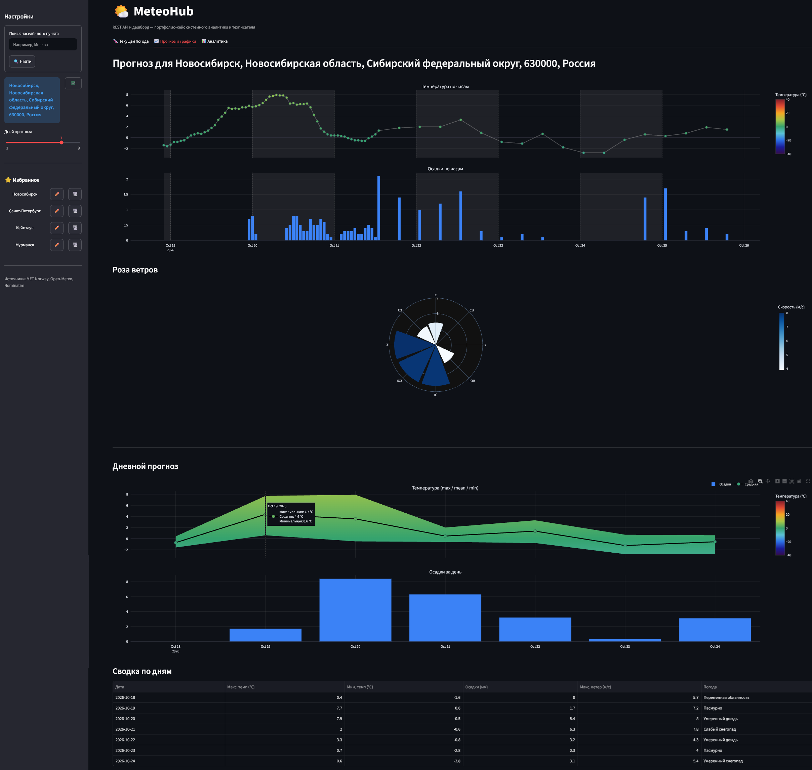
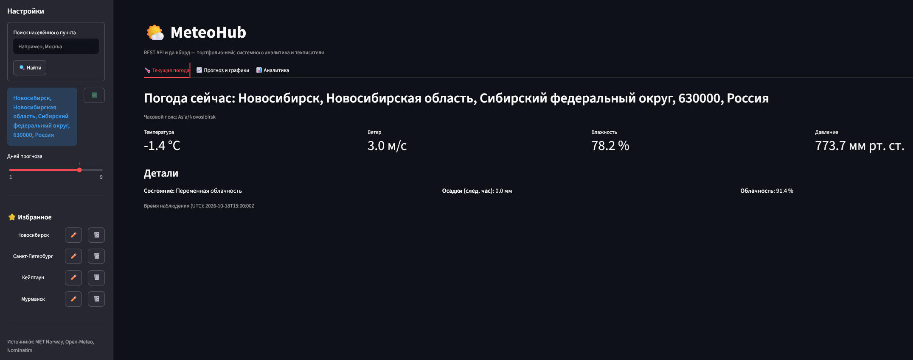
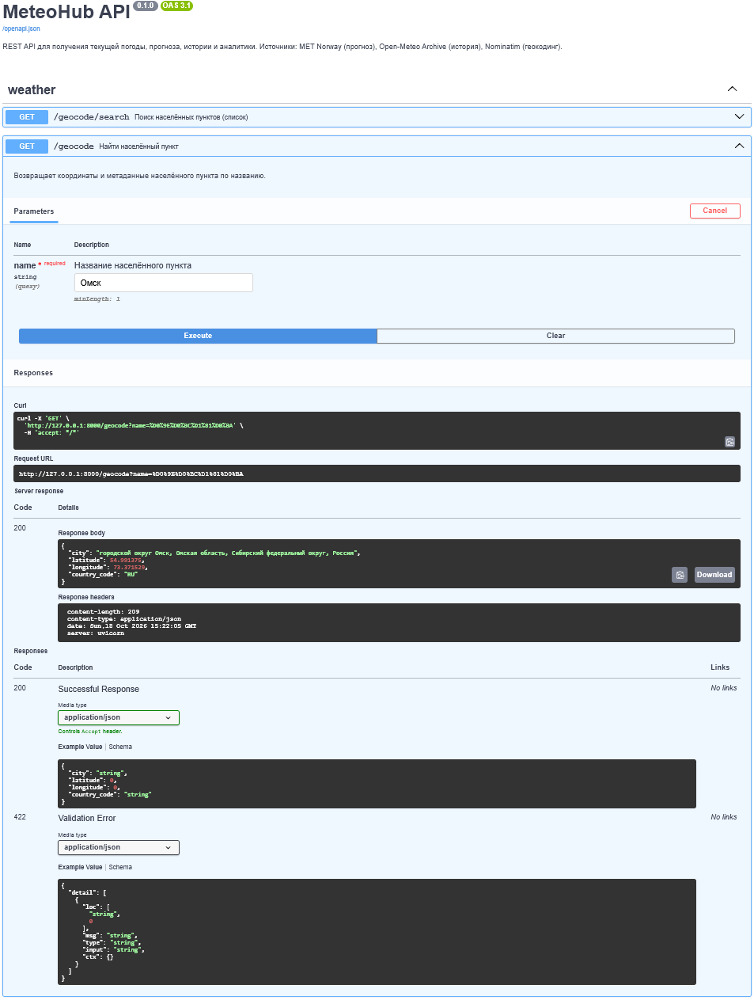
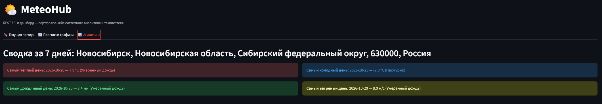

# MeteoHub

REST API и дашборд для получения текущей погоды, прогноза, исторических
данных и аналитики через открытые API (MET Norway, Open-Meteo, Nominatim).

Проект выполнен как портфолио-кейс по двум профессиям:
**системный / бизнес-аналитик** и **технический писатель**.

Документация проекта следует [стайлгайду pet-проектов](../06-job-search-crm/docs/style-guide/01-style-guide.md).

> *Скриншот общего вида приложения: боковая панель (поиск, избранное) и дашборды на вкладке «Прогноз и графики» с почасовыми и дневными графиками.*

## Статус

✅ **MVP выпущен — 100% готовности.**

| Этап | Статус |
|------|--------|
| 0. Фундамент проекта | ✅ Готово |
| 1. База данных (схема, миграции, подключение) | ✅ Готово |
| 2. Интеграции (MET Norway, Open-Meteo, Nominatim) | ✅ Готово |
| 3. REST API (FastAPI + Swagger) | ✅ Готово |
| 4. Дашборд (Streamlit, графики, аналитика) | ✅ Готово |
| 5. Запуск в один клик (bat-файлы) | ✅ Готово |
| 6. Документация (руководства, диаграммы, Postman) | ✅ Готово |

**Ключевые особенности:**
- Поддержка нескольких источников данных (MET Norway, Open-Meteo, Nominatim).
- Встроенный кэш в PostgreSQL для минимизации запросов к внешним API.
- Автоматический расчёт аналитики (самый тёплый/холодный/дождливый/ветреный день).
- Учёт часовых поясов: графики строятся в локальном времени выбранного населённого пункта.
- Единицы измерения: °C, мм, м/с, мм рт. ст.
- Интерактивный поиск: поиск населённого пункта с выбором из списка вариантов (обработка дубликатов названий).
- Избранное: сохранение до 5 городов с возможностью переименования.

## Демонстрация

<table>
  <tbody>
    <tr>
      <td>
         
        <strong>Вкладка «Текущая погода»: метрики и детали</strong>
      </td>
      <td rowspan="2" valign="top">
         
        <strong>Swagger UI: интерактивная документация API</strong>
      </td>
    </tr>
    <tr>
      <td>
         
        <strong>Вкладка «Аналитика»: сводка за 7 дней</strong>
      </td>
    </tr>
  </tbody>
</table>

## Стек

Python 3.14 · FastAPI · PostgreSQL · Streamlit · Plotly · Open-Meteo · MET Norway · Nominatim

## Структура проекта

| Папка | Содержимое |
|-------|------------|
| `app/` | FastAPI-приложение, роутеры, сервисы интеграций |
| `ui/` | Streamlit-дашборд (графики, аналитика, поиск) |
| `db/` | Скрипты подключения, миграции, SQL-запросы |
| `docs/` | Документация (руководства, диаграммы, глоссарий, скриншоты) |
| `postman/` | Коллекции для тестирования API и файл спецификации `openapi.json` |
| `tests/` | Скрипты ручной проверки и дымовые тесты |

## Запуск

Самый быстрый способ — запустить **`run-all.bat`**. Скрипт откроет два окна:
1. **API** (Uvicorn) — http://127.0.0.1:8000/docs
2. **UI** (Streamlit) — http://127.0.0.1:8501

Альтернативные команды:
- `run-api.bat` — только API;
- `run-ui.bat` — только UI (требует запущенного API).

Полная инструкция по установке на чистой Windows 10/11 — в [Руководстве администратора](docs/user-docs/04-admin-guide.md).

## Документация

| Документ | Назначение |
|----------|------------|
| [**Глоссарий**](docs/user-docs/01-glossary.md) | Единый словарь терминов и сокращений. |
| [**Журнал изменений (Changelog)**](docs/user-docs/02-changelog.md) | История версий продукта и планы на будущее (Roadmap). |
| [**Руководство пользователя**](docs/user-docs/03-user-guide.md) | Как искать города, работать с графиками и избранным. |
| [**Руководство администратора**](docs/user-docs/04-admin-guide.md) | Инструкция по развертыванию, настройке БД и запуску. |
| [**Руководство разработчика**](docs/user-docs/05-developer-guide.md) | Архитектура, структура кода, настройка UI. |
| [**Sequence-диаграмма**](docs/process/01-sequence.md) | Взаимодействие компонентов при запросе прогноза. |
| [**ER-диаграмма**](docs/data-model/01-er-diagram.md) | Структура базы данных PostgreSQL. |
| [**Реестр рисков**](docs/risks/01-risk-register.md) | Анализ рисков и способы их митигации. |
| [**OpenAPI-спецификация**](postman/openapi.json) | Сырая спецификация API в формате JSON (OpenAPI 3.1). |
| [**Postman-коллекции**](postman/README.md) | Инструкция по тестированию API в Postman. |