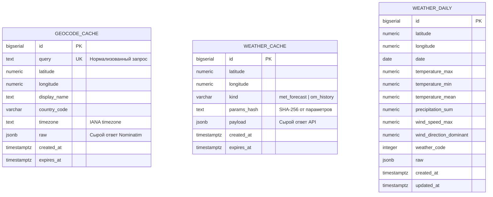

# ER-диаграмма базы данных MeteoHub

| | |
|---|---|
| Версия | 1.0 |
| Дата | 18.10.2026 |
| Автор | Юрий Савиных |
| Статус | Утверждён автором |
| Связанные документы | [Sequence-диаграмма](../process/01-sequence.md), [Руководство разработчика](../user-docs/05-developer-guide.md) |

## 1. Назначение документа

Документ описывает логическую и физическую структуру базы данных PostgreSQL, используемую для кэширования ответов внешних API и хранения дневных агрегатов.

## 2. ER-диаграмма (Mermaid)

## 3. Описание таблиц

В базе данных нет классических связей «Один-ко-Многим» через внешние ключи (Foreign Keys). Это осознанное решение для кэша: таблицы привязаны к координатам `(latitude, longitude)` и нормализованному поисковому запросу.

### 3.1. `geocode_cache`
Хранит результаты поиска населенных пунктов.
*   **`query` (UNIQUE):** Гарантирует, что один и тот же поисковый запрос не будет сохранен дважды.
*   **`expires_at`:** Время жизни (TTL) — 24 часа. По истечении записи запрос снова уйдет в Nominatim.

### 3.2. `weather_cache`
Хранит сырые ответы от MET Norway и Open-Meteo Archive.
*   **`kind`:** Разделяет типы данных (прогноз или история).
*   **`params_hash`:** Хэш параметров запроса (например, `{"start_date": "2023-01-01", "end_date": "2023-01-07"}`). Вместе с координатами и `kind` образует уникальный ключ `(latitude, longitude, kind, params_hash)`.

### 3.3. `weather_daily`
Хранит дневные агрегаты (максимумы, минимумы, суммы) для быстрого построения аналитики без повторного парсинга сырых JSON.
*   **Уникальный ключ:** `(latitude, longitude, date)`. Если прогноз обновился, запись перезаписывается через `UPSERT`.
*   **`weather_code`:** Числовой WMO-код для отображения иконок и описаний.

## 4. Журнал изменений

| Версия | Дата | Изменения |
|--------|------|-----------|
| 1.0 | 18.10.2026 | Первая версия: описаны три таблицы, объяснен отказ от внешних ключей в пользу составных ключей кэша. |