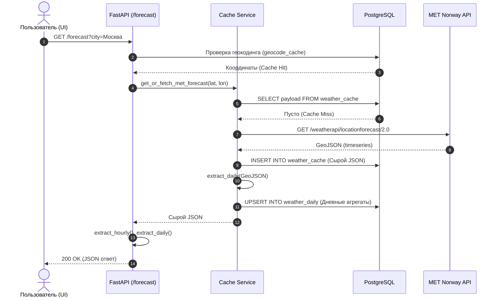

# Sequence-диаграмма: запрос прогноза

| | |
|---|---|
| Версия | 1.0 |
| Дата | 18.10.2026 |
| Автор | Юрий Савиных |
| Статус | Утверждён автором |
| Связанные документы | [Руководство разработчика](../user-docs/05-developer-guide.md), [ER-диаграмма](../data-model/01-er-diagram.md) |

## 1. Назначение документа

Документ описывает последовательность взаимодействия компонентов системы при запросе прогноза погоды. Диаграмма демонстрирует логику работы кэша и процесса агрегации данных.

## 2. Диаграмма последовательности (сценарий кэш-промаха)

## 3. Описание шагов

1. **Запрос пользователя:** UI отправляет GET-запрос с названием города.
2. **Разрешение города:** API обращается к кэшу (или Nominatim), чтобы получить координаты.
3. **Проверка кэша погоды:** API просит сервис кэша найти прогноз по координатам. Если запись есть и не истекла (Cache Hit) — данные сразу возвращаются.
4. **Запрос к внешнему API (Cache Miss):** Если данных нет, сервис обращается к MET Norway.
5. **Сохранение:** Сырой ответ сохраняется в `weather_cache`.
6. **Агрегация:** Попутно данные пересчитываются в дневные показатели и сохраняются в `weather_daily` для последующей аналитики.
7. **Ответ:** API форматирует данные и возвращает пользователю.

## 4. Журнал изменений

| Версия | Дата | Изменения |
|--------|------|-----------|
| 1.0 | 18.10.2026 | Первая версия: описан сценарий с кэш-промахом. |