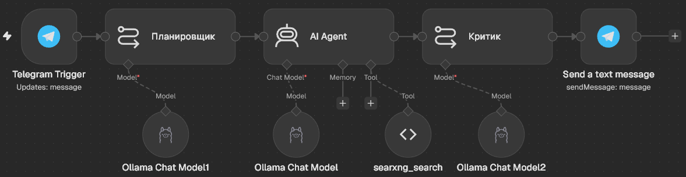
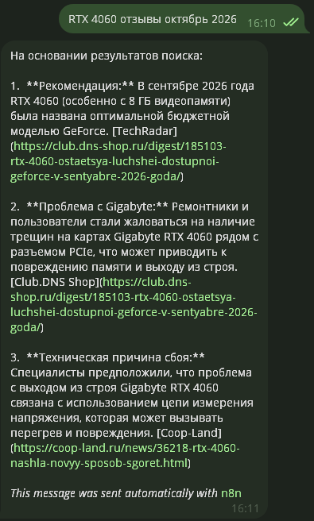
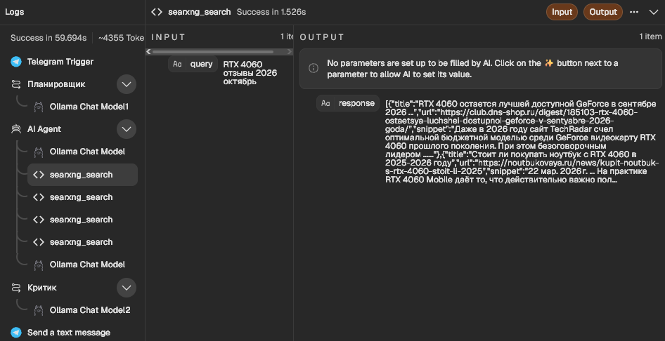

# Deep Research Agent

Мультиагентная система мониторинга рынка и сбора данных с отправкой структурированных дайджестов в Telegram.

Проект выполнен как портфолио-кейс по профессиям:
**системный аналитик (AI-решения)** и **технический писатель**.

> *Скриншот пайплайна в n8n: Telegram Trigger -> Planner -> AI Agent (Researcher) -> Critic -> Telegram.*

## Статус

✅ **MVP выпущен — 100% готовности.**

| Этап | Статус |
|------|--------|
| 0. Фундамент (Docker, n8n, SearXNG, Ollama) | ✅ Готово |
| 1. Интеграция Telegram (Webhooks, Cloudflare Tunnel) | ✅ Готово |
| 2. Роль Researcher (поиск и очистка данных) | ✅ Готово |
| 3. Роль Planner (декомпозиция задач) | ✅ Готово |
| 4. Роль Critic (фильтрация «воды», аналитика) | ✅ Готово |
| 5. Документация (архитектура, реестр промптов, ADR) | ✅ Готово |

**Ключевые особенности:**
- **Мультиагентная архитектура (Hub & Spoke):** Разделение ролей на Планировщика (декомпозиция), Исследователя (поиск) и Критика (анализ).
- **Использование локальных LLM:** Применение `deepseek-r1:8b` для reasoning-задач и `qwen2.5:7b` для вызова инструментов (tool calling) через Ollama.
- **Управление контекстом:** Кастомный Code-узел обрезает сырой JSON от SearXNG, оставляя только `title`, `url` и `snippet` (сокращение контекста в 5 раз для предотвращения галлюцинаций).
- **Отказоустойчивость:** Обработка невалидного Markdown от LLM, защита от зацикливания ответов бота на собственные сообщения.
- **Инфраструктура:** Полностью контейнеризировано (Docker Compose), настроен публичный доступ к вебхукам через Cloudflare Tunnel.

## Демонстрация

<table>
  <tbody>
    <tr>
      <td>
         
        <strong>Пример ответа в Telegram: структурированный дайджест со ссылками</strong>
      </td>
      <td rowspan="2" valign="top">
         
        <strong>Логи n8n: вызов инструмента и очистка JSON</strong>
      </td>
    </tr>
  </tbody>
</table>

## Стек

n8n · Ollama (deepseek-r1, qwen2.5) · SearXNG · Docker · Cloudflare Tunnel · Telegram Bot API

## Структура проекта

| Папка | Содержимое |
|-------|------------|
| `workflows/` | JSON-экспорт воркфлоу из n8n (для импорта) |
| `docs/` | Описание архитектуры, реестр промптов, ADR, скриншоты |
| `docker-compose.yml` | Файл развертывания n8n и SearXNG |

## Запуск

1. Запустите Ollama локально и скачайте модели: `ollama pull deepseek-r1:8b` и `ollama pull qwen2.5:7b`.
2. Установите переменную окружения `OLLAMA_HOST=0.0.0.0:11434`.
3. Запустите инфраструктуру: `docker compose up -d`.
4. Импортируйте `workflows/deep_research_agent.json` в ваш n8n.
5. Настройте Credential для Telegram и Ollama.
6. Запустите Cloudflare Tunnel (`cloudflared tunnel --url http://localhost:5678`) и пропишите `WEBHOOK_URL` в compose-файле.
7. Активируйте воркфлоу (Publish) и напишите боту.

Полная инструкция по установке — в [Руководстве по развертыванию](docs/01-architecture.md).

## Документация

| Документ | Назначение |
|----------|------------|
| [**Архитектура и пайплайн**](docs/01-architecture.md) | Описание взаимодействия агентов, ролей и потоков данных. |
| [**Реестр промптов (Prompt Registry)**](docs/02-prompt-registry.md) | Системные промпты для Planner, Researcher и Critic с обоснованием. |
| [**ADR (Architecture Decision Records)**](docs/03-adr.md) | Почему выбраны Code Tool, deepseek-r1 и как решалась проблема контекста. |