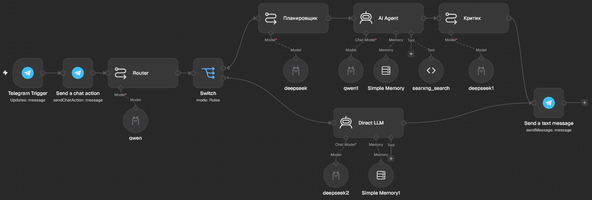

# Архитектура системы Universal AI Assistant

## 1. Назначение системы

Система представляет собой универсального ИИ-ассистента в Telegram. Главная особенность — **интеллектуальная маршрутизация запросов (Router Pattern)**. Система анализирует запрос пользователя и выбирает оптимальный путь выполнения: 
1. **DIRECT:** Мгновенный ответ на основе базовых знаний модели (для кода, переводов, простых фактов).
2. **RESEARCH:** Глубокий анализ с поиском в интернете (для новостей, трендов, сравнений).

## 2. Схема пайплайна

Архитектура построена на базе n8n и использует условное ветвление.

## 3. Компоненты системы и их роли

| Компонент (узел n8n) | Модель / Технология | Назначение |
| :--- | :--- | :--- |
| **Telegram Trigger** | Telegram Bot API | Прием сообщения. |
| **Send a chat action** | Telegram Bot API | Отправка статуса `typing` (`печатает...`) для улучшения UX. |
| **Router** | `qwen2.5:7b` | Классификатор намерений. Определяет, нужен ли поиск. |
| **Switch** | n8n | Направляет поток в ветку DIRECT или RESEARCH. |
| **Direct Agent** | `deepseek-r1:8b` + Memory | Отвечает на общие вопросы без поиска. |
| **Planner** | `deepseek-r1:8b` | Декомпозиция сложного запроса на поисковые фразы. |
| **Researcher (AI Agent)** | `qwen2.5:7b` + Code Tool + Memory | Вызов SearXNG и очистка данных. |
| **Critic** | `deepseek-r1:8b` | Синтез данных, фильтрация «воды», оформление ответа. |

## 4. Поток данных (Data Flow)

1. **Прием:** `Telegram Trigger` получает запрос. Сразу после него узел `Send a chat action` отправляет статус `typing` (`печатает...`).
2. **Классификация:** Узел `Router` анализирует текст и возвращает одно слово: `RESEARCH` или `DIRECT`.
3. **Ветвление:** Узел `Switch` направляет поток:
   * **Ветка DIRECT:** `Direct Agent` отвечает на вопрос, используя `Simple Memory` (история диалога по `chat_id`).
   * **Ветка RESEARCH:** `Planner` генерирует запросы -> `Researcher` ищет и очищает JSON -> `Critic` пишет аналитический дайджест.
4. **Отправка:** Узел `Send a text message` использует универсальное выражение `{{ $json.output || $json.text }}` для получения текста из любой ветки и отправляет его в чат.

## 5. Инфраструктура и развертывание

- **n8n и SearXNG** работают в Docker-контейнерах.
- **Ollama** работает нативно на хосте с использованием GPU.
- **Публичный доступ:** Вебхуки Telegram требуют HTTPS, поэтому локальный n8n опубликован через `Cloudflare Tunnel`.
- **Память:** Встроенный `Simple Memory` в n8n хранит историю последних 20 сообщений в оперативной памяти контейнера n8n (сбрасывается при перезапуске).